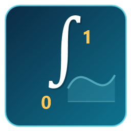
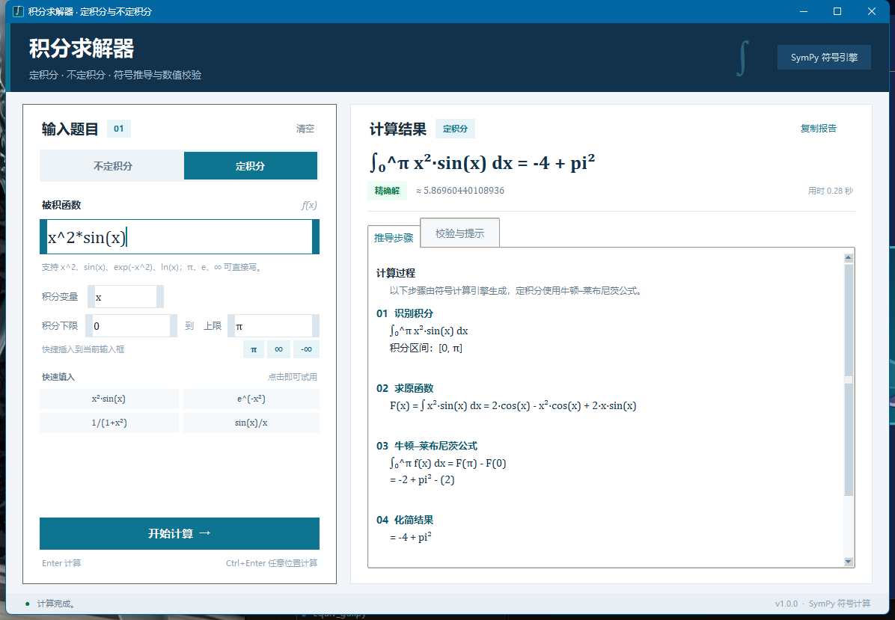

# 积分求解器

一个基于 Python + SymPy 的中文积分计算程序，支持**不定积分**与**定积分**，提供图形界面和命令行两种用法。

程序不仅给出结果，还会展示原函数、牛顿–莱布尼茨代入过程，并用**求导验算**或**独立数值积分**做交叉校验；对发散、未定义、无初等原函数的积分会明确提示。

<p align="center">
  
</p>

<p align="center">
  <a href="https://github.com/ccyfjkdjhf-wq/integral-solver/releases/latest/download/IntegralSolver-Standalone.exe">
    
  </a>
</p>

<p align="center">
  <strong>免安装版不需要安装 Python，下载后双击即可使用。</strong>
</p>



## 功能

- 不定积分：自动添加积分常数 `C`，并对结果求导验算。
- 定积分：支持有限区间、无穷区间和带符号参数的积分限。
- 上下限快捷输入：点击 `π`、`∞`、`-∞` 按钮即可插入到当前正在编辑的上限或下限。
- 发散与未定义识别：例如 `∫₀¹ 1/x dx`、`∫₀^π tan(x) dx`。
- 无初等原函数时：保留积分形式；若是数值定积分，则给出高精度数值近似。
- 自动校验：不定积分用求导校验，定积分用独立数值积分交叉验证。
- 输入友好：支持 `x^2`、`x²`、`2x`、`πx`、`√x`、`|x|`、`∫ x^2 dx` 等写法。
- 结果可复制为完整的纯文本报告；命令行支持 JSON 输出，便于二次开发。
- 全中文界面，Windows 下双击即可启动。

## 下载与运行

| 版本 | 是否需要 Python | 适用场景 | 下载 |
| --- | --- | --- | --- |
| **免安装版（推荐）** | 不需要 | 下载后双击直接使用 | [IntegralSolver-Standalone.exe](https://github.com/ccyfjkdjhf-wq/integral-solver/releases/latest/download/IntegralSolver-Standalone.exe) |
| **源码版** | 需要 Python 3.10+ | 查看/修改源码、使用命令行 | [IntegralSolver-Windows.zip](https://github.com/ccyfjkdjhf-wq/integral-solver/releases/latest/download/IntegralSolver-Windows.zip) |

### 免安装版（无需 Python）

1. 点击下载 `IntegralSolver-Standalone.exe`（约 28 MB）。
2. 双击运行，无需安装 Python、SymPy 或其他依赖。
3. 支持 Windows 10/11 64 位。

> 该程序未做代码签名，Windows 可能显示“Windows 已保护你的电脑”或“未知发布者”。点击 **“更多信息” → “仍要运行”** 即可。这是未签名程序的正常提示，不代表文件有问题。

### 源码版（需要 Python）

1. 下载 `IntegralSolver-Windows.zip` 并解压。
2. 把得到的文件夹放到桌面或任意目录。
3. 双击文件夹里的 **`启动积分求解器.bat`**。
4. 首次运行会自动创建 `.venv` 并安装 SymPy，需要联网；之后可离线使用。

如果启动器提示找不到 Python，请安装 [Python 3.10+](https://www.python.org/downloads/)，安装时勾选 **Add Python to PATH**。

也可以直接克隆源码：

```bat
git clone https://github.com/ccyfjkdjhf-wq/integral-solver.git
cd integral-solver
```

### 手动启动源码版

```bat
python -m venv .venv
.venv\Scripts\python.exe -m pip install -r requirements.txt
.venv\Scripts\python.exe main.py
```

## 命令行用法

命令行功能包含在源码版中；免安装版双击后直接打开图形界面。

双击 **`命令行模式.bat`** 会打开交互式命令行。也可以直接使用：

```bat
:: 不定积分
.venv\Scripts\python.exe main.py --cli "x^2*sin(x)"

:: 定积分
.venv\Scripts\python.exe main.py --cli "exp(-x^2)" --bounds 0 oo

:: 无穷区间
.venv\Scripts\python.exe main.py --cli "1/(1+x^2)" --bounds -oo oo

:: JSON 输出
.venv\Scripts\python.exe main.py --cli "sin(x)" --bounds 0 pi --json --no-steps

:: 交互模式
.venv\Scripts\python.exe main.py --cli
```

常用参数：

| 参数 | 说明 |
| --- | --- |
| `--var x` | 指定积分变量，默认为 `x` |
| `--bounds A B` | 指定定积分的下限和上限 |
| `--digits N` | 数值近似与校验的有效数字位数，默认 15 |
| `--no-steps` | 只输出结果与校验，不输出推导步骤 |
| `--json` | 输出便于程序处理的 JSON |
| `--help` | 查看完整帮助 |

退出码：`0` 成功；`1` 内部错误；`2` 输入错误。

## 输入语法

| 写法 | 含义 |
| --- | --- |
| `x^2`、`x**2`、`x²` | 乘方 |
| `2x`、`2*x`、`2(x+1)` | 隐式乘法 |
| `sin(x)`、`sin x`、`sin^2(x)` | 三角函数 |
| `asin` / `arcsin`、`atan` / `arctan` | 反三角函数 |
| `exp(x)`、`e^x` | 指数函数 |
| `ln(x)`、`log(x)` | 自然对数 |
| `lg(x)`、`log10(x)` | 常用对数 |
| `sqrt(x)`、`√x`、`x^(1/2)` | 平方根 |
| `Abs(x)`、`\|x\|` | 绝对值 |
| `pi`、`π` | 圆周率 |
| `oo`、`∞` | 无穷大 |
| `I` | 虚数单位 |
| `∫ x^2 dx` | 可直接粘贴，末尾 `dx` 会自动去掉 |

定积分的上下限填写在单独输入框中，支持 `0`、`1`、`pi`、`∞`、`-∞`、`a+1` 等表达式。也可以点击输入框下方的 `π`、`∞`、`-∞` 快捷按钮，符号会插入到当前正在编辑的上限或下限。上下限中不能出现积分变量本身。

## 结果说明

- **精确解**：SymPy 找到闭式结果，并已完成校验。
- **数值近似**：没有找到闭式结果，或符号积分失败，程序使用数值积分给出近似值。
- **无闭式解**：保留未计算的积分形式；如果是定积分，通常还会给出数值结果。
- **发散 / 未定义**：例如积分区间内有无穷间断点、积分趋于无穷，或结果不存在。
- **提示**：结果含符号参数、区间含奇点、结果含虚部、数值校验存在差异等情况，会在“校验与提示”中说明。

> 求导验算和数值积分校验都是辅助检查，不是形式化证明。对于分支切割、主值积分和极难化简的表达式，仍建议结合数学判断。

## 项目结构

```text
integral-solver/
├─ main.py                    # 程序入口（默认 GUI，--cli 进入命令行）
├─ launcher.py                # 自动准备运行环境并启动
├─ integral_solver/
│  ├─ core.py                 # 解析、积分、化简、校验、格式化
│  ├─ gui.py                  # Tkinter 图形界面
│  └─ cli.py                  # 命令行界面
├─ tests/
│  ├─ test_core.py            # 计算内核测试
│  ├─ test_cli.py             # 命令行测试
│  └─ test_gui.py             # 图形界面烟雾测试
├─ docs/
│  ├─ screenshot.png          # 界面预览
│  ├─ app_icon.png            # 应用图标（256 px）
│  └─ app_icon.ico            # 多尺寸应用图标
├─ requirements.txt
├─ 启动积分求解器.bat
├─ 命令行模式.bat
└─ README.md
```

## 运行测试

```bat
.venv\Scripts\python.exe -B -m unittest discover -s tests -v
```

## 已知限制

- 本项目计算的是**定积分/不定积分**，不处理含未知函数的 Fredholm、Volterra 型积分方程。
- 符号积分没有通用算法能保证对任意初等函数都得到初等原函数；程序会保留积分形式并提示。
- 极端复杂或振荡强烈的积分可能耗时较长。计算在后台线程中执行，窗口不会卡死，但目前不提供强制中断。
- SymPy 对实数区间上的某些积分可能返回复分支结果或柯西主值；程序会给出相应提示，请结合数学背景判断。

## 技术栈

- Python 3.10+
- [SymPy](https://www.sympy.org/) 符号计算
- Tkinter 桌面界面
- PyInstaller 免安装打包
- `unittest` 自动化测试
